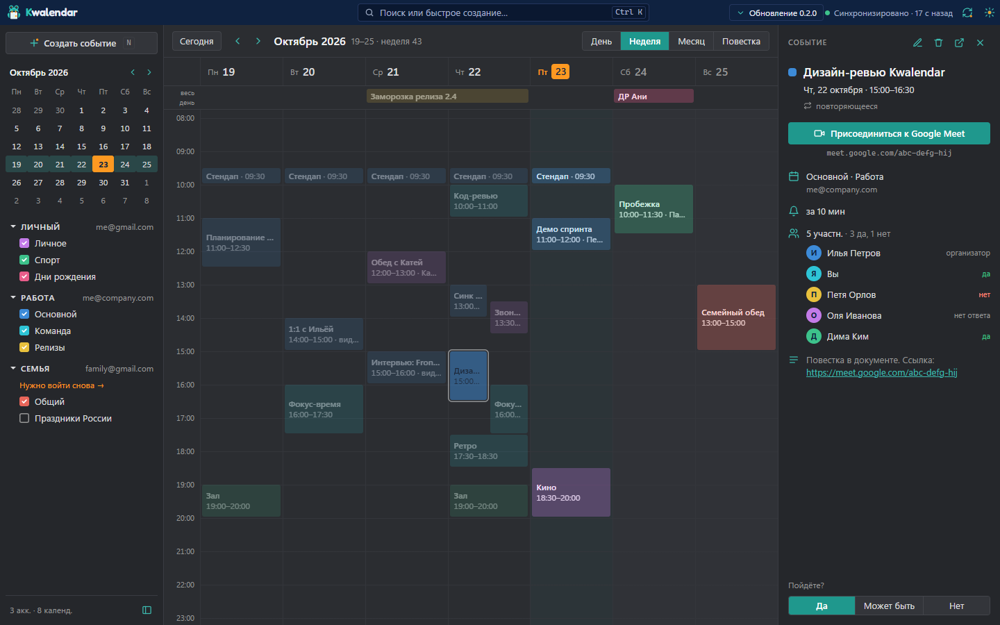
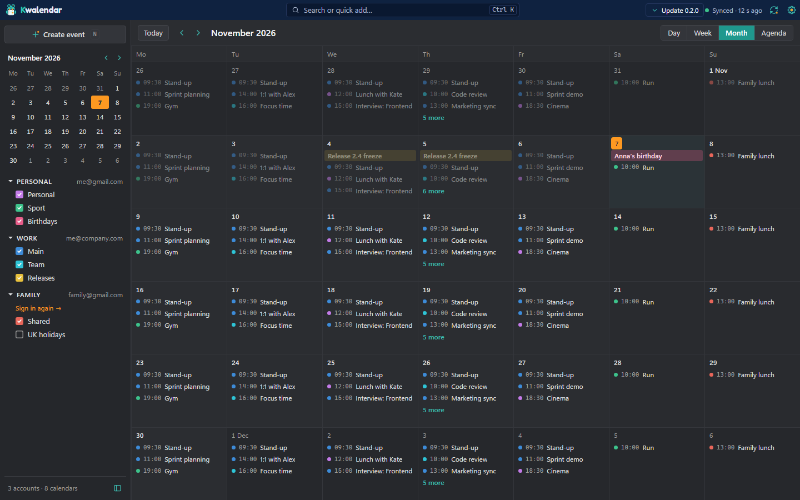
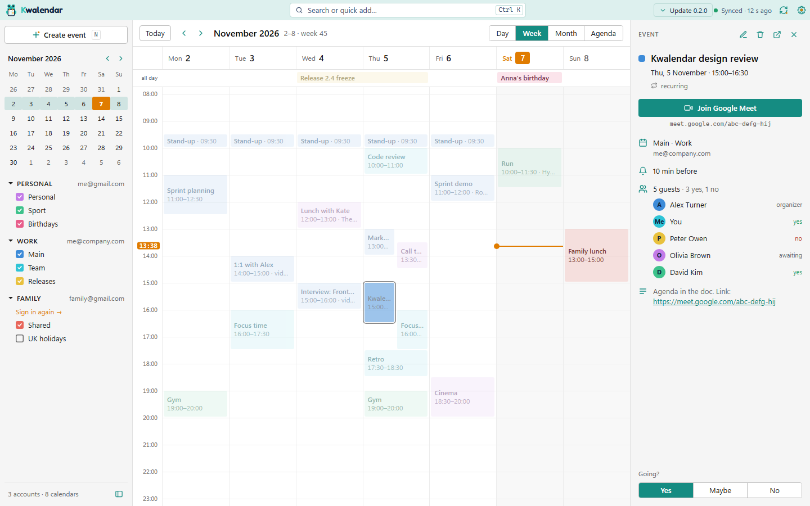

<p align="center"></p>

# Kwalendar

A fast, lightweight desktop calendar for Google Calendar, for Windows, written in Rust.

Kwalendar shows the calendars of all your Google accounts — personal, work, family — in one
window. It keeps a local copy of your calendars, so it opens instantly and keeps working offline,
and it reminds you about meetings with native Windows notifications. The UI is
[SolidJS](https://www.solidjs.com/) in a [Tauri 2](https://tauri.app/) shell (WebView2); sync,
storage, recurrence and reminders live in a Rust core that never blocks the window.

> **AI-generated code.** Everything in this repository — source code, tests, scripts,
> installers, CI workflows and documentation — was written by an AI model (Anthropic's
> Claude, through Claude Code), directed and reviewed by a human. The logo concept was supplied
> by the project owner. No code was copied from other projects; third-party code is used only as
> normal dependencies under their own licenses (see [Third-party software](#third-party-software)).

> Status: 0.1.0. Windows 10/11 x64 is the target; the core and the UI are cross-platform, macOS and
> Linux builds are not published yet.



<p>
  
  
</p>

## Features

- **Several Google accounts in one view**: calendars of every connected account side by side,
  each calendar can be shown or hidden; day, week, month and agenda views; mini month.
- **Events**: create, edit, delete; drag to move, drag the bottom edge to resize, drag on an
  empty slot to create; all-day and multi-day events; recurring events (edit just this
  occurrence or the whole series); attendees and RSVP (yes / maybe / no); Google Meet links.
- **Quick add** (`Ctrl+K`, or `Ctrl+Alt+K` from anywhere in Windows): type
  *"Call with Peter tomorrow at 3pm for 30 min #work"* — date, time, duration and calendar are
  parsed (English and Russian); also searches your events and shows conflicts.
- **Reminders**: Windows notifications with *Join* (Meet / Zoom / Teams) and *Snooze* buttons,
  caught up after the PC wakes from sleep; notices when someone moves a meeting or invites you;
  *Do not disturb for 1 hour* from the tray.
- **Offline first**: the window reads only the local database; changes are applied instantly
  and sent to Google from a queue when the network is back, with conflict handling
  (the server version wins and you are told).
- **Tray app**: closing the window keeps Kwalendar in the tray; optional start with Windows.
- **Styles**: dark and light themes (or follow Windows), in the restrained *Kwak* look shared
  with [GitKwaken](https://github.com/maxpowerart/GitKwaken).
- **Self-update** from GitHub releases, with a version picker and rollback (see
  [Updates and going back](#updates-and-going-back)).

## How sync works

- **Incremental**: Google's `syncToken` returns only what changed since the last check — usually
  an empty answer of a few hundred bytes. All calendars of an account are checked in **one
  batched HTTP request**.
- **When**: every 30 s while the window is focused, every 3 min in the tray, and right away after
  wake-up from sleep, network reconnect or switching back to the window.
- **First start**: the visible weeks are fetched first so the screen fills in seconds, then the
  full history loads in the background.
- **Push (optional)**: deploy the tiny [relay](relay/README.md) (a free Cloudflare Worker) and
  enter its address in Settings › Sync. Google then notifies Kwalendar within seconds through
  `events.watch`, and polling drops to a rare safety net. The relay never sees event contents.

## Installing

Grab `Kwalendar_<ver>_x64-setup.exe` from the
[Releases page](https://github.com/maxpowerart/Kwalendar/releases): a per-user installer (no admin
rights) with a Start-menu entry; it upgrades in place. Requirements: Windows 10 or 11 x64 with
the WebView2 runtime (preinstalled on Windows 11).

Then *Add Google account* and sign in in your browser. Until the app finishes Google's
verification, Google shows *"Google hasn't verified this app"*: choose *Advanced › Go to
Kwalendar*. Work accounts on Google Workspace may block apps their admin has not configured
(*"You can't access this app until an admin…"*): the admin can allow Kwalendar in the Admin
console under *Security › Access and data control › API controls › Manage third-party app access*.

Your data stays on your PC: see the [Privacy Policy](https://kwasoftware.org/Kwalendar/privacy.html).

## Updates and going back

Kwalendar checks the latest GitHub release at startup and every 6 hours. A newer one shows a
button in the title bar: it opens the release's changelog with *Update and restart*, *Later* and
*Skip this version*. The installer is downloaded, verified against its SHA-256, installed
silently after Kwalendar exits, and the app starts again.

- **Install another version** (Settings › Updates): lists every release; any of them can be
  installed, older ones included, e.g. to go back after an update that went wrong. Going back
  uninstalls the current version first; accounts, settings and the local calendar copy are kept.
- **Withdrawing a bad release** (maintainers): run the *Withdraw release* workflow
  (Actions › Withdraw release) with the version and a reason. The release is marked
  "(withdrawn)" and as a pre-release, and the update channel goes back to the newest good
  release, so nobody is offered the bad one any more. Installations already running it show
  *Version withdrawn* with the reason and offer the good version. Running the workflow with
  *restore* undoes it.

Release notes come from [CHANGELOG.md](CHANGELOG.md): the release workflow copies the
`## <version>` section into the update channel and the GitHub release.

## Building

```sh
# Rust stable (MSVC toolchain), Node 20+, WebView2
npm install
npm run tauri dev          # run with hot reload
npm run tauri build        # release build + NSIS / MSI installers
cargo test -p kw-core      # core tests, including end-to-end sync against a fake Google API
npm run dev                # UI only, in a browser, on demo data (http://localhost:1420)
```

**Google OAuth client.** Release builds embed the project's *Desktop app* OAuth client, so users
only sign in. Locally, put your own client in an untracked `oauth.local.json` at the repository
root (it is git-ignored):

```json
{ "client_id": "…apps.googleusercontent.com", "client_secret": "GOCSPX-…" }
```

or set `KW_GOOGLE_CLIENT_ID` / `KW_GOOGLE_CLIENT_SECRET`. CI reads them from repository secrets of
the same names. A build without a client asks for one on the welcome screen
(Google Cloud Console › Credentials › *OAuth client ID* › *Desktop app*).

**Releasing.** Bump `version` in `src-tauri/tauri.conf.json`, add a `## <version>` section to
[CHANGELOG.md](CHANGELOG.md), then push a tag:

```sh
git tag v0.2.0 && git push origin main v0.2.0
```

The *Release* workflow runs the tests, builds the installer and publishes the GitHub release with
`update.json`.

## Keyboard shortcuts

| Shortcut | Action |
|---|---|
| `Ctrl+K` | Quick add and search |
| `Ctrl+Alt+K` | Quick add from any app (global) |
| `N` | New event |
| `T` | Today |
| `J` / `→`, `K` / `←` | Next / previous period |
| `1` `2` `3` `4` | Day / week / month / agenda |
| `E` / `Del` | Edit / delete the selected event |
| `Ctrl+B` | Toggle sidebar |
| `F5` | Sync now |
| `Ctrl+,` | Settings |

## Architecture

| Part | Role |
|---|---|
| `crates/kw-core` | Everything that is not UI, with no Tauri dependency: SQLite store (WAL), Google Calendar API client and batch requests, OAuth (loopback + PKCE, tokens in the Windows Credential Manager), incremental sync and the outbox of local changes, recurrence expansion (RRULE / EXDATE and exceptions), reminder scheduler, push channels, self-update. |
| `src-tauri` | The `kwalendar` executable: Tauri commands, tray, Windows toasts with actions, autostart, global shortcut, single instance, installer-based updates. |
| `ui` | SolidJS + TypeScript front end; runs in a browser on demo data for development. |
| `relay` | Optional Cloudflare Worker for Google push notifications. |
| `docs` | [Stack and architecture notes](docs/STACK.md), the project site (GitHub Pages) and screenshots. |
| `design` | Logo sources and the [style guide](design/STYLE.md). |

## License

Licensed under either of

- Apache License, Version 2.0 ([LICENSE-APACHE](LICENSE-APACHE))
- MIT license ([LICENSE-MIT](LICENSE-MIT))

at your option. Unless you explicitly state otherwise, any contribution intentionally submitted
for inclusion in the work by you, as defined in the Apache-2.0 license, shall be dual licensed as
above, without any additional terms or conditions.

The code is AI-generated (see the note at the top). In some jurisdictions purely
machine-generated material may not be eligible for copyright; the licenses above apply to
whatever rights exist in it and, either way, grant you the same freedoms.

### Third-party software

Kwalendar depends on Rust crates (Tauri, reqwest, rusqlite with a bundled SQLite, rrule, chrono,
keyring and others) and npm packages (SolidJS, chrono-node, Tauri API), used unmodified under
their own permissive licenses (MIT, Apache-2.0, BSD, ISC, Zlib and similar). The Fredoka font
(SIL Open Font License 1.1) is embedded for the wordmark.

### Trademarks

Kwalendar is an independent project, not affiliated with or endorsed by Google or Microsoft.
Google Calendar, Google Meet and Google Workspace are trademarks of Google LLC; Windows and Outlook
are trademarks of Microsoft Corporation. Product names are used only to describe compatibility.
